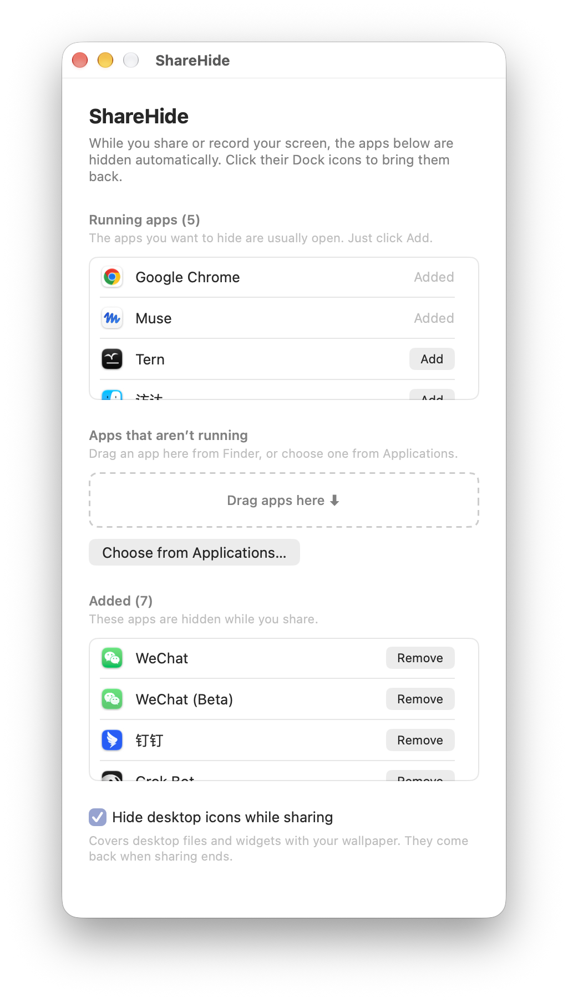

# ShareHide (macOS)

[简体中文](README.md) | English

Automatically hides the apps you choose while your screen is being captured, so chat windows don't show up when you share in a meeting, record your screen, or give a demo.

- When sharing or recording starts, the apps you picked are hidden.
- They don't pop back on their own afterwards; click a Dock icon when you need one.
- You decide which apps to hide. Nothing is hidden by default.
- Optional: cover your desktop icons with the wallpaper while sharing; they come back when sharing ends.

## Install

Open Terminal, paste this line and press Return:

```bash
curl -fsSL https://raw.githubusercontent.com/iamvicliu/share-hide-apps/main/install.sh | bash
```

When it finishes, the settings window opens. Add the apps you want to hide; changes take effect right away, and ShareHide starts automatically at login.

> If you'd rather not run `curl | bash` blindly, read [install.sh](install.sh) and the source ([main.swift](main.swift), [sharewatch.swift](sharewatch.swift), [config-gui.swift](config-gui.swift)) first.

## Add apps to hide



After installing, choose "Settings…" from the menu bar icon, or open ShareHide in `~/Applications`. There are three ways to add an app:

1. Click "Add" next to it under "Running apps" (easiest, since the apps you want to hide are usually open).
2. Drag the app from Finder onto the drop area.
3. Click "Choose from Applications…" and pick it.

## Hide desktop icons

Turn on "Hide desktop icons while sharing" at the bottom of the settings window. While you share, the files and widgets on your desktop are covered with your wallpaper, and they come back when sharing ends. Turning it on or off takes effect right away. It's off by default.

To bring the icons back in the middle of a share, either:

- Right-click an empty spot on the desktop and choose "Show Desktop Icons (This Time Only)". "Stop Hiding Desktop Icons" turns the feature off altogether.
- Or click the menu bar icon and choose "Show Desktop Icons". Choose it again to hide them.

Showing the icons only lasts for the current share; they're covered again the next time you share. While the desktop is covered, clicking it won't open the files underneath, and you can't drag files onto it.

## Menu bar icon

After installing, an eye-with-a-slash icon appears in the menu bar. Click it to see the current status, open the settings window, or quit.

- Closing the settings window (the ✕ at the top left) only hides the window. ShareHide keeps working and the menu bar icon stays.
- To actually quit, choose "Quit ShareHide" from the menu bar icon or press ⌘Q in the settings window. Open ShareHide again to bring it back; it also starts automatically at your next login.

## Notes

- Apps are hidden, not restored automatically: click a Dock icon when you need an app again.
- Any meeting or recording app that captures the screen triggers hiding; it doesn't matter which one.
- For extra safety, turn off "Allow notifications when mirroring or sharing the display" in System Settings → Notifications.

## Uninstall

```bash
curl -fsSL https://raw.githubusercontent.com/iamvicliu/share-hide-apps/main/uninstall.sh | bash
```

## Requirements

macOS 12 or later, on Intel or Apple silicon. The interface follows your system language (Chinese or English).

---

## Technical details

### How it works

Once a second, ShareHide asks the system whether the screen is being continuously captured (meeting shares and screen recordings both count). After two checks in a row say yes, it hides the apps you configured. Everything runs locally: no network access, no reading of window contents, no data collection.

The settings file is `~/Library/Application Support/ShareHideApps/apps.conf`. It's re-read every time sharing starts, so edits take effect immediately.

### Build it yourself

`ShareHideApps` in this repo is a prebuilt universal binary (Intel + Apple silicon, ad-hoc signed). The menu bar icon, share detection and settings window all live in this one program. To build it yourself:

```bash
swiftc -O -target arm64-apple-macos12  main.swift sharewatch.swift config-gui.swift -o sha-arm64
swiftc -O -target x86_64-apple-macos12 main.swift sharewatch.swift config-gui.swift -o sha-x86
lipo -create sha-arm64 sha-x86 -output ShareHideApps && codesign -s - --force ShareHideApps
```

### Known limitations

- It relies on the private macOS API `CGSIsScreenWatcherPresent`, which may need updating after a major system upgrade.
- Hiding desktop icons works by placing a layer of wallpaper over the desktop; Finder settings are not changed. For dynamic wallpapers only one frame can be read, so the cover may look slightly different from what's currently shown.

---

## Disclaimer

This project is not affiliated with Tencent, Alibaba, Apple or any other company. App names are used only as examples.

## License

Released under the [MIT License](LICENSE).
