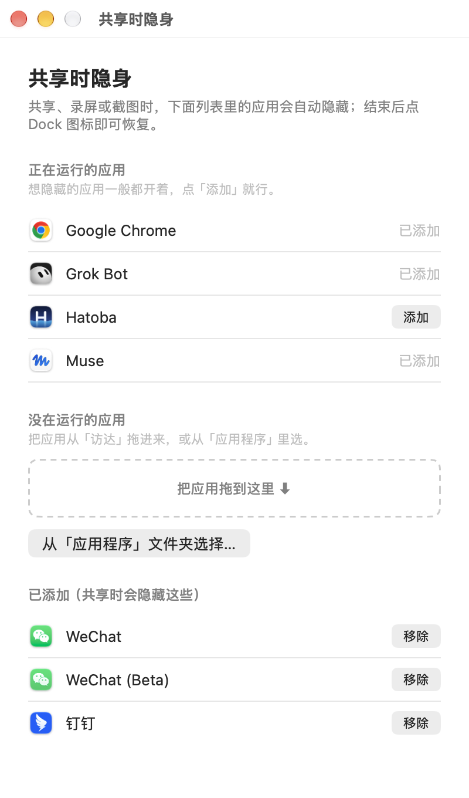

# 共享时隐身（macOS）

屏幕被采集时自动隐藏你指定的应用，避免演示、录屏或会议共享时露出微信、钉钉等窗口。

- 共享 / 录屏 / 截图开始时：自动隐藏你选定的应用。
- 停止后不会自动弹回，需要时点 Dock 图标即可。
- 隐藏哪些应用由你自己配置，默认不隐藏任何应用。

## 安装

打开「终端」，粘贴下面这行并回车：

```bash
curl -fsSL https://raw.githubusercontent.com/iamvicliu/share-hide-apps/main/install.sh | bash
```

装好后会弹出配置窗口，把要隐藏的应用加进去即可，设置立即生效，之后开机自动运行。

> 介意 `curl | bash` 的话，可以先把 [install.sh](install.sh) 和源码（[sharewatch.swift](sharewatch.swift)、[config-gui.swift](config-gui.swift)）看一遍再运行。

## 添加要隐藏的应用




安装后，在 `~/Applications` 里有一个「共享时隐身」配置程序，随时打开即可管理。三种方式添加：

1. 从「正在运行的应用」列表点「添加」（最省事，想隐藏的应用通常都开着）。
2. 把应用从「访达」拖进拖拽区。
3. 点「从『应用程序』文件夹选择…」挑选。

## 菜单栏图标

安装后，菜单栏右上角会出现一个眼睛划线图标。点开可以看当前状态、打开配置窗口，或退出后台。

从菜单退出后，后台会停止，下次登录时自动重新启动。

## 注意事项

- 只隐藏、不自动恢复：共享结束后，需要时自己点 Dock 图标即可。
- 任何会议、录屏、截图软件触发屏幕采集都会生效，不区分是哪一款软件。
- 建议在「系统设置 → 通知」里关掉「镜像或共享显示器时允许通知」，双重保险。

## 卸载

```bash
curl -fsSL https://raw.githubusercontent.com/iamvicliu/share-hide-apps/main/uninstall.sh | bash
```

## 适用环境

macOS 12 及以上，Intel 与 Apple 芯片均可。

---

## 技术细节

### 原理

程序每秒调用一次系统接口判断屏幕是否正在被采集（会议共享、录屏、部分截图工具都会触发），连续两次判定为「正在采集」就隐藏你配置的应用。纯本地运行，不联网、不读取任何窗口内容、不收集数据。

配置文件保存在 `~/Library/Application Support/ShareHideApps/apps.conf`，后台每秒重读，改完即时生效。

### 自己编译

仓库里的 `sharewatch`（后台）和 `hideapps-config`（配置程序）都是预编译的通用二进制（Intel + Apple 芯片，ad-hoc 签名）。想自己编译：

```bash
# 后台
swiftc -O -target arm64-apple-macos12  sharewatch.swift -o sw-arm64
swiftc -O -target x86_64-apple-macos12 sharewatch.swift -o sw-x86
lipo -create sw-arm64 sw-x86 -output sharewatch && codesign -s - --force sharewatch
# 配置程序（同样的方式编译 config-gui.swift 得到 hideapps-config）
```

### 已知限制

- 用的是 macOS 的系统私有接口 `CGSIsScreenWatcherPresent`，系统大版本升级后可能需要更新。

---

## 免责声明

本项目与腾讯、阿里巴巴、Apple 等公司无关，文中的应用名仅作示例。

## 许可证

基于 [MIT 许可证](LICENSE) 开源。
